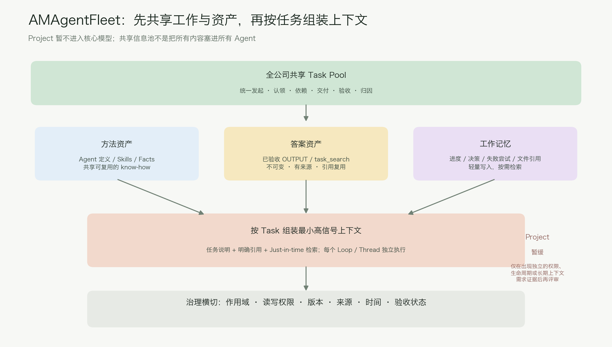

# Agent Fleet：共享任务池、共享信息资产与 Project 必要性评估

- 日期：2026-11-01
- 状态：调研结论，建议用于修订 Project PRD 与下一开发切片
- 方法：优先采用 Anthropic／Claude 官方文档与工程文章、Cognition 原文、Steve Yegge 原文、Letta 官方文档；X 只采用能够追溯到原始帖子或原始文章的内容
- 证据边界：这些实践大多来自 coding／research agents，不能直接证明通用企业 Agent Fleet 的唯一正确架构；本文把它们作为设计证据，而非行业统计结论

## 执行摘要

**建议暂停把 Project 作为下一核心 MVP，优先实现已经接受但尚未落地的“全公司共享答案库＋`task_search`＋引用型交付”。** 上一版直接推荐 Project MVP 过早：它把传统项目管理中的长期容器当成了 Agent Fleet 的必需要素，却没有先证明现有 Task 层级、共享任务池、方法资产和已验收答案库无法表达同一需求。

你的判断基本准确，但需要补一个重要限定：公开实践确实更常围绕共享任务列表、任务依赖、消息信箱、外部工作记忆和按任务传递上下文展开，而不是先创建 Project；不过“没有以 Project 为核心”不等于“反对任何项目级作用域”。Claude Managed Agents 支持按用户、团队或项目划分记忆存储，Gas Town 也有 Rig 和 Convoy。[Gas Town](https://github.com/gastownhall/gastown) 因此，本项目应当否定的是**现在新增一个重型、全能的 Project 业务实体**，而不是永久否定轻量项目标签或上下文分区。

对 AMAgentFleet 更合适的目标模型是：**一个全公司共享 Task Pool，三类可复用信息资产，按 Task 动态组装最小高信号上下文。** 信息共享指“可发现、可引用、可归因、按权限取用”，不指“所有 Agent 永远看到所有内容”，也不指“所有对话和文件自动注入后续任务”。

## 一手实践究竟共享什么

| 实践 | 实际共享的协调与信息状态 | 明确没有共享或受到限制的内容 | 对本项目的启示 |
|---|---|---|---|
| Anthropic Research 多 Agent | Lead 拆分任务；子 Agent 有明确目标、边界和输出格式；大结果写入外部系统，向协调者返回轻量引用 | 不靠所有子 Agent 拥有同一个上下文；强依赖、需要共同上下文的工作被明确视为较差适配 | 共享任务说明、产物引用和必要记忆，而非完整历史。[Anthropic](https://www.anthropic.com/engineering/built-multi-agent-research-system) |
| Claude Code Agent Teams | 共享任务列表、任务依赖、认领状态、消息信箱；队友可直接通信 | 每个队友有独立上下文；不会继承 Lead 的完整对话，只加载项目约定、技能和本次任务说明 | 与现有 Task／Loop／Thread 模型高度同构，应先强化任务池，而非再包一层 Project。[Claude Code Docs](https://code.claude.com/docs/en/agent-teams) |
| Anthropic 16 Agent C 编译器实验 | 共享 Git 仓库、任务锁、进度文档、失败尝试和测试反馈；没有中央编排 Agent | 当所有 Agent 都处理同一个内核故障时，并行失效且互相覆盖；必须把问题拆成不同文件和故障 | 任务可分解性与反馈质量比 Agent 数量或组织层级更重要；共享信息必须帮助下一份工作发现。[Anthropic](https://www.anthropic.com/research/building-c-compiler), [Anthropic on X](https://x.com/AnthropicAI/status/2019496582698397945) |
| Cognition／Devin | 强调相关决策和完整 agent trace 的共享；强依赖工作优先保持单线程连续上下文 | 反对把复杂任务拆给只拿到简短消息的多个 Agent；摘要不足以传递隐含决策 | 不能为了共享池而过度拆分；对强依赖任务，应续用同一 Thread 或传递相关决策轨迹。[Cognition](https://cognition.ai/blog/dont-build-multi-agents) |
| Beads／Gas Town | 结构化 issue／任务图成为跨会话工作记忆；状态、依赖、认领和审计可查询 | 反对把大量层级计划散落在 Markdown 文件中；但 Gas Town 仍保留 Rig、Convoy 等分组 | 支持“任务池即共享工作记忆”；同时也说明分组并非绝对无用，只应是轻量工作视图。[Steve Yegge](https://yegge.ai/essays/introducing-beads-a-coding-agent-memory-system/), [Gas Town](https://github.com/gastownhall/gastown) |
| Claude Managed Agents Memory | 记忆存储按用途、所有者、用户、团队或项目分区；在 Session 创建时显式挂载，支持只读、版本和并发前置条件 | 官方最佳实践明确不建议一个大而全的通用存储 | 信息共享应是可挂载、可审计的作用域，而不是全局可写记忆。[Claude Platform Docs](https://platform.claude.com/docs/en/managed-agents/memory) |
| Letta Shared Memory | 共享记忆块或 Git 仓库可挂载给多个 Agent；共享知识、约定、研究和工作文件 | 按需挂载，并非组织内所有 Agent 自动获得；写入和同步仍需治理 | 未来若需要长期共享资料，可先实现 Context Collection／Memory Store，不必立刻引入 Project 生命周期。[Letta](https://docs.letta.com/concepts/shared-memory/) |

这些材料不存在一个完全统一的“最佳架构”。Anthropic 在可独立研究的问题上从隔离上下文受益，Cognition 则强调强依赖工作中的上下文断裂风险。两者共同否定的不是多 Agent 或共享记忆本身，而是**未经任务分解、没有相关决策传递、却指望更多 Agent 自动产生可靠结果的设计**。因此，Fleet 的核心应是任务语义、执行边界、验收和上下文组装的纪律，而不是实体数量。

## 为什么 Project 现在不是正确的下一切片

仓库既有决议已经把系统定位为“任务市场＋know-how 固化机＋已验收答案库”，并明确全公司唯一共享任务池、方法共享、结果走池和执行隔离。Project PRD 中的交付积累、后续任务检索旧成果、方法复用，大部分已经属于这套模型，而不是一个尚不存在的新需求。[shared-pool-concurrency](../design/shared-pool-concurrency.md)

更关键的是，ADR-0014 已接受三层资产模型：`Agent／Skills／Facts` 构成方法层，已验收交付构成答案层，Thread／Checkpoint／Run Events 构成轨迹层；`task_search` 和引用型交付正是跨 Task 复用的操作入口。当前代码检索显示，这些能力仍主要停留在文档中：Control Plane 没有搜索端点，FAP 协议没有对应 operation，`fleet_tools.py` 也没有 `task_search`。新增 Project 会绕开最直接影响用户价值的未实现缺口。[0014-answer-library-task-search](../adr/0014-answer-library-task-search.md)

Project PRD 还把长期说明、共享资料、交付历史、权限和生命周期一次性绑定到一个实体上，带来数据模型、权限、上下文注入、文件管理和 Console 信息架构的联动成本。它可能最终有价值，但当前没有先验证一个更轻的 Context Collection、任务标签、父子 Task 或搜索视图能否满足需求。按照 Anthropic“只在简单方案不足时增加复杂度”的原则，这一步缺乏必要性证据。[Anthropic](https://www.anthropic.com/engineering/building-effective-agents)

## “全公司共享信息池”需要改成什么定义

建议采用**共享信息资产层**，而不是单一信息池。它至少分为三类：方法资产负责复用“怎么做”，答案资产负责复用“已经做成的结果”，工作记忆负责保留“当前进展、关键决策、失败尝试和资料引用”。三类信息可以全公司可发现，但不应全部进入每个 Agent 的上下文；每个 Task 启动时只组装任务说明、明确引用和少量高信号内容，执行中再通过搜索和文件引用按需取回。

共享也不等于全局可写。已验收 OUTPUT 应保持不可变；共享规范默认只读；工作记忆需要来源、时间、作者、版本和作用域；敏感资料需要显式授权；自动提炼的 facts 不应成为结果数据的旁路。Anthropic 对上下文工程的建议是寻找“最小的高信号 token 集合”，这与全量注入 Project 历史的方向相反。[Anthropic](https://www.anthropic.com/engineering/effective-context-engineering-for-ai-agents)

## 修订后的开发顺序

### 第一优先级：完成 ADR-0014 的信息复用闭环

1. 在 Control Plane 实现已接受的任务搜索端点，覆盖 Task 输入、交付和评论，返回验收状态、交付时间、来源 Task、认领者与链接。
2. 将搜索注册进统一 FAP 操作清单，再向 Runner 暴露 `task_search`，保持 actor、审计、只读和能力发现语义一致。
3. 实现引用型交付与验收链路，确保旧答案不能被 Agent 未经当前验收直接冒充新成果。
4. 增加创建 Task 时的相似已验收任务提示，先使用现有 PG 检索，避免过早引入向量基础设施。
5. 用真实任务夹具测量搜索命中率、引用复用率、重复执行减少量、错误旧答案采纳率和 token 节省，而不是先建设 Project 页面。

### 第二优先级：补轻量工作记忆与上下文清单

在每个 Task／Loop 中沉淀简短进度、关键决策、失败尝试和外部资料引用；新 Loop 或后续 Task 能明确看到本次继承了哪些内容。若多个 Task 反复需要同一组资料，再引入可命名、可挂载、可只读共享的 **Context Collection**。它是信息作用域，不负责管理 Task，不复制 Project 的完整生命周期。

### 重新启动 Project 评审的触发条件

只有当实际使用反复出现以下证据时，才重新评审 Project：长期说明和资料需要独立所有者、权限与归档生命周期；同一上下文包需要跨大量 Task 稳定复用且 Context Collection 无法表达；用户需要围绕长期目标查看跨 Task 进展，而父子 Task、标签或保存视图无法提供；或者安全边界要求默认拒绝无关任务访问，现有全透明池已不再成立。届时的 Project 更可能是一个**轻量作用域或保存视图**，而不是天然包含所有资料和全部历史的重型容器。

## 最终建议

**不创建 `feat/fleet-project-mvp`，下一开发分支改为围绕 `feat/task-search-answer-library`。** 先把已决议的信息共享闭环落地，再用使用数据决定是否需要 Project。游戏表现层继续以真实 Agent、Task Pool 和 Task 群聊为主；Project 会议桌保持禁用，不用 dummy Project 数据反向证明业务模型合理。
