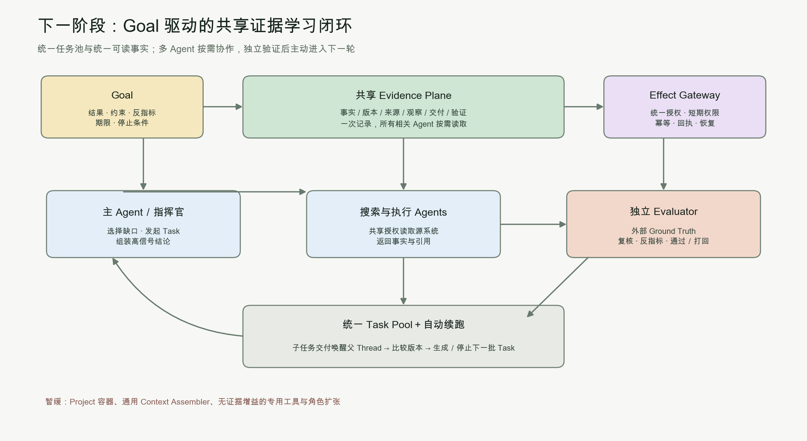

# AMAgentFleet 下一阶段方向：Goal 驱动的共享 Evidence 学习闭环

- 日期：2026-11-01
- 依据：用户提供的三轮对抗报告、报告关键原始来源复核、当前主仓库、Task 318–320 真实协作实测
- 结论性质：方向修订建议，不代表真实 GEO 效果已经产生

> **评估边界修正（以 README 第 4 节为准）**：本文初版把第三方 `geo-evidence-01` 的业务闭环误列为平台第一切片。正确划分是：AMAgentFleet 的平台第一切片为 `fleet-eval-01`，用于验收任务编排、自动唤醒、多 Agent 协作和 Playground 等平台能力；`geo-evidence-01` 仅是第三方运行评估与接入 canary，其业务评分由运营方负责。本文下述 GEO 内容只用于理解第三方运行闭环，**不纳入 AMAgentFleet 项目完成度评分，也不作为平台开发优先级。**

## 执行摘要

下一阶段应从“Project／通用上下文装配／通用 `task_search`”转向 **Goal 驱动的共享 Evidence 学习闭环**：所有 Agent 使用同一任务池、同一套可读事实与统一授权能力，主 Agent 根据目标缺口发起任务，搜索与执行 Agent 返回带来源的事实，独立 Evaluator 验证结果，平台自动唤醒主 Agent 组装并决定下一轮，直到满足停止条件。

统一共享上下文和统一授权都应当保留。需要修正的不是“共享太多”，而是共享的实现方式：**事实通过共同 Evidence Plane 共享，授权通过 Gateway／Vault 共享；不把私有记忆当权威事实，不把秘密文本当普通上下文复制。** 当前实测中测试密码进入子 Task 输入，属于实现违背既有安全红线，不说明统一授权本身错误。

平台首个开发切片是 `fleet-eval-01`：用平台控制的参考负载验证 Agent 发现、并行执行、自动唤醒、组装、独立评价和停止。`geo-evidence-01` 只作为后续第三方接入 canary，验证注册、执行、恢复、隔离、证据与权限契约的可复用性。

## 重新判断“凭据共享是不是问题”

| 共享对象 | 是否应该共享 | 推荐发生层 | 不应采用的方式 |
|---|---|---|---|
| 产品事实、指标定义、任务状态、源记录、验证结果 | 应该，且应尽量只有一份权威记录 | 共享 Evidence Plane／源系统 | 每个 Agent 私有保存不同版本并相互转述 |
| 检索能力与业务系统接入 | 应该，一次接入，多 Agent 复用 | MCP Gateway／受控工具桥 | 每个 Agent 独立重新接入、重复鉴权 |
| 密码、Access Token、Refresh Token | 可以共享“使用权限”，不应共享“正文” | Vault＋Gateway 内存注入＋短期授权 | 写入 Task input、Thread、Checkpoint、审计或模型上下文 |
| 方法与技能 | 应该共享并允许过期 | 版本化 Agent YAML／Skills／Evidence | 永久累积、无来源、无复审 |

当前仓库已经明确规定 MCP 凭据是 server 级共享，同时禁止 access token 进入 Runner 环境、Checkpoint、日志和审计正文。这意味着现有战略本来就是“统一授权、秘密不出 Gateway”，不需要通过放松红线来实现共享。[shared-pool-concurrency](../design/shared-pool-concurrency.md), [AGENTS](../../AGENTS.md)

因此，对上次实测更准确的结论是：指挥官需要能够方便地把 Timeline 检索任务交给其他 Agent，这个需求完全合理；但它通过记忆把私有路径和测试密码复制进两个子 Task，说明当前接入方式把“授权共享”错误降级成了“秘密文本共享”。应当修接入层，不应减少 Agent 之间的数据协作。

## 报告真正支持的三条主线

### 统一任务池与共享可读事实

OpenAI 的 Harness 把仓库知识作为系统记录，使用短入口、结构化文档、进度与决策日志，让所有 Agent 从同一版本化事实源工作，而不是依赖人类复制粘贴或各自记忆。Symphony 则把开放任务作为控制面，并进一步从固定状态机转向给 Agent 目标。[OpenAI Harness](https://openai.com/index/harness-engineering/), [OpenAI Symphony](https://openai.com/index/open-source-codex-orchestration-symphony/)

Vercel 的 d0 也证明，当共享语义层已经足够清晰时，直接让 Agent 读取共同文件比维护一批专用检索工具更快、更省 Token。这里的关键不是文件这种介质，而是**事实已可读、可发现、可验证**；如果源数据混乱，简单增加共享访问只会加速错误。[Vercel](https://vercel.com/blog/we-removed-80-percent-of-our-agents-tools)

### 多 Agent 围绕目标主动迭代

Anthropic 的长任务实验使用 Planner、Generator、Evaluator，并通过文件在 Agent 之间传递契约、结果和评价。它的价值不只是并行检索，而是“生成→独立评价→反馈再生成”的学习循环；独立验证使用真实应用和外部行为，而不是生成者自评。[Anthropic](https://www.anthropic.com/engineering/harness-design-long-running-apps)

报告提出的 Goal／Task／Evidence／Effect 四个经营对象与此一致：Goal 定义结果、约束、反指标和停止条件；Task 推进最小工作；Evidence 证明事实；Effect 记录谁在什么权限下改变世界以及回执。它并不要求先建立重型 Project 容器。AI原生公司方法论与AM激进重构_三轮对抗迭代_2026-11-01

### 主动循环必须有成本与退出门

同一个 Anthropic 实验中，完整 Harness 相比单 Agent 超过 20 倍成本，后续通过删除 Sprint、降低评估频率来简化。报告也要求看每个验证成果的人类时间与总成本，而不是 Agent 数量和任务量。由此不能得出“循环越多越好”，只能得出“在验证收益大于协调与错误成本时保留循环”。[Anthropic](https://www.anthropic.com/engineering/harness-design-long-running-apps)

我们的实测同样需要这个约束：指挥官能自主派发两个检索 Agent，并在外部唤醒后发现两个 worker 的数字错误；但首轮提前结束、需要人工续跑，累计计量达到 1,663,450 Token，且输出超出字数要求。因此它证明的是多 Agent 信息组装可行，并没有证明这种协作已经自主、便宜或可规模复制。fleet-autonomous-context-summary

## 当前架构与目标闭环的差距

| 能力 | 当前已有 | 真正缺口 | 下一阶段处理 |
|---|---|---|---|
| Task 控制面 | 全局 Task Pool、竞争 Loop、父子 Task、验收、恢复 | 子任务交付不会自动唤醒父 Thread；Task 完成不等于 Goal 收敛 | 增加事件驱动续跑与 Goal 停止判断 |
| 共享上下文 | Agent YAML、Skills、Facts、Task OUTPUT、Thread 历史 | 缺统一、版本化、可读的 Evidence；私有记忆容易成为二手真相 | 先用共享文件与 OUTPUT 引用形成 Evidence Plane |
| 统一授权 | Gateway、server 级 secrets、egress、PAT | 实测仍会把秘密复制进子 Task；Effect 回执尚未成为业务一等记录 | 统一 credential handle＋Gateway 注入，保留现有红线 |
| 多 Agent 协作 | 指挥官能发现 Agent、并行派发、读取 OUTPUT 并纠错 | 没有可靠的“子完成→父续跑→独立评价→下一轮”循环 | 用真实 Goal 驱动，而非增加更多角色 |
| 验收 | 强制验收、人与 Agent 同构、审计 | 缺基于外部 Ground Truth 的自动评价与反指标 | 确定性小闭环自动验收，高风险仍由人承诺 |
| 经营指标 | Token、Task、Loop、运行状态 | 缺每个验证成果的成本、人类时间和单 Agent 对照 | 加入净价值评估，失败即删流程 |

当前概念模型以 Agent／Task／Loop／Thread／Run／Message 为主，没有 Goal／Evidence／Effect 业务层；这不妨碍先运行闭环，但说明不能仅靠在现有 Task 上增加搜索接口就获得主动学习能力。[concept-model](../design/concept-model.md)

## 修订后的开发顺序

### 第一优先级：真实 `geo-evidence-01` 两轮闭环

复用报告所列的六题固定面板、产品事实、双语换电草稿、中性采样和评分资产，先跑基线，再做逐主张核验、增量修订和复测。生产写入、公开发布和外部承诺保持关闭。报告明确说明当前只有实现合同与契约测试，真实两轮采样尚未完成；当前主仓库又没有对应文件，因此最大的缺口是真实执行与接入，不是继续写规划。

首轮必须加入单 Agent 对照，使用相同题面、证据和模型 Profile，比较事实准确率、证据完整性、总 Token、耗时与人类介入分钟。只有多 Agent 方案在质量或成本上产生净收益，才保留指挥官＋搜索 Agent＋独立 Evaluator 的结构；否则退回更简单的执行方式。

### 第二优先级：只补闭环需要的平台能力

1. **共享 Evidence Plane**：先使用版本化文件、观察记录、事实卡和现有 Task OUTPUT 引用，不急着建统一向量库或新数据库。
2. **自动续跑**：子 Task 交付或独立 Evaluator 完成后，自动唤醒对应父 Thread；不得再依赖人工发送“现在请整合”。
3. **Goal 续跑与停止**：比较基线和复测，依据预设停止条件生成下一批 Task 或结束；防止无限循环和 backlog 自动膨胀。
4. **统一授权句柄**：搜索 Agent 通过共享 credential handle 使用源系统，父 Agent 只传 Goal 与数据范围，不传秘密正文。
5. **成本与效果记录**：每轮保存版本、证据、Token、耗时、人工分钟和验证结果，支持删除无收益步骤。

Goal 初期可以是版本化 YAML，Evidence 初期可以是可读文件与引用，Effect 初期可以复用幂等和审计记录。**只有真实闭环证明这些抽象有必要，才把它们升级为通用表结构和协议 API。**

### 第三优先级：验证后才抽象与扩展

两轮闭环稳定后，再决定是否增加通用 `tasks.search`、Goal API、Evidence API、自动验收和更多业务连接器。若扩展不能改变当前决策或结果，就不开发。Project、通用 Context Assembler、全公司统一向量库和更多专职 Agent 均不进入近期主线。

## 首轮验收门

| 维度 | 必须证明 |
|---|---|
| 真实观察 | 六题均得到真实回答或明确错误，保存原文、最终引用、时间和设置 |
| 事实核验 | 每个主张有 supported／incorrect／unresolved 与来源，未决数字不被擅自选值 |
| 两轮迭代 | 有实际增量稿、复测和版本比较，不把一次交付称为学习闭环 |
| 自动协作 | 子任务完成后无需人工催促即可唤醒主 Agent 组装并进入评价或下一轮 |
| 共享与权限 | 所有 Agent 使用同一证据版本和统一授权；秘密正文不进入 Task／Thread |
| 净价值 | 相对单 Agent，质量提升足以覆盖额外 Token、时间和协调成本 |
| 安全退出 | 无生产写入、无公开发布、无虚构 GEO 改进；失败可停止、可恢复 |

最终判断：**项目下一阶段不应继续围绕“怎样设计更多信息容器”，而应围绕“怎样让一个真实 Goal 在共享事实和统一授权上，自动完成两轮可验证学习”。**这正是当前已有 Task Pool 与实测多 Agent 能力之间最缺失的一层。
